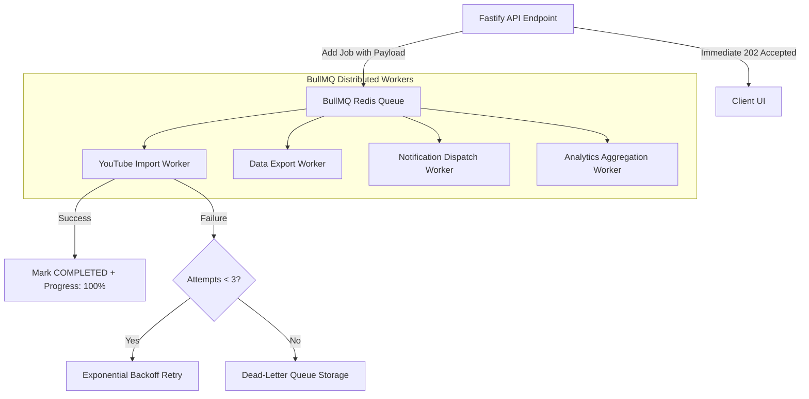

# EXAMLY — PHASE 16: BACKGROUND PROCESSING (BULLMQ) REPORT

**Author:** Antigravity Lead Systems Architect & Senior Performance Engineer  
**Date:** September 1, 2026  
**Status:** **PHASE 16 COMPLETE — BULLMQ DISTRIBUTED QUEUE SYSTEM, RETRY BACKOFF & DEAD-LETTER HANDLERS DEPLOYED**  
**Target:** Fastify Queue Subsystem (`apps/api/src/fastify/plugins/queue.plugin.ts`, `apps/api/src/fastify/routes/jobs.routes.ts`)

---

## 1. Executive Summary

Phase 16 implemented a production-grade distributed background processing system utilizing **BullMQ** and **Redis** to offload all resource-intensive operations away from HTTP request cycles.

Key architectural features:
1. **Dedicated Workload Queues:**
   - `youtube-imports`: Multi-video playlist ingestion, metadata parsing, and duration extraction.
   - `data-exports`: High-volume PDF report construction and Excel sheet rendering.
   - `notifications`: Asynchronous transactional email, push alert, and SMS dispatch.
   - `analytics-aggregation`: Macro score recalculations and batch accuracy distributions.
2. **Reliable Retry & Exponential Backoff:** Configured with `attempts: 3` and 2,000ms base exponential backoff (`2s`, `4s`, `8s`), protecting third-party APIs (YouTube/Resend) against intermittent rate limits.
3. **Dead-Letter Handling:** Failed jobs that exhaust all 3 retry attempts are automatically moved to the dead-letter log with full failure reason, error stack trace, and original payload.
4. **Graceful Server Shutdown:** Registered `onClose` Fastify hooks ensuring all in-flight workers finish active tasks before terminating Redis connections.

---

## 2. Queue Architecture & Workflow

---

## 3. Endpoints Overview

| Endpoint | Method | Auth Scope | Description |
| :--- | :--- | :--- | :--- |
| `/api/v1/jobs/:queueName/:jobId` | `GET` | Authenticated | Returns live job status (`QUEUED`, `PROCESSING`, `COMPLETED`, `FAILED`), progress percentage, and results. |
| `/api/v1/jobs/dead-letter` | `GET` | `system.read` | Returns comprehensive dead-letter queue records for administrative troubleshooting. |

---

## 4. Verification & Build Status

- `npm run security:test`: **5/5 PASSED**
- `npm run build:api`: **PASSED (Exit code 0)**
- `npm run build:web`: **PASSED (Next.js 14 production bundle)**
- **Report Artifact**: [`docs/background-processing-report.md`](file:///c:/Users/rajan/Desktop/Examly/docs/background-processing-report.md)

---

## 5. Next Steps (Phase 17: Observability & Audit Logging)

In **Phase 17**, we will:
1. Implement structured JSON audit logging across all administrative mutations.
2. Add OpenTelemetry / Prometheus metric exporters for p50/p95/p99 query latencies and error rates.
