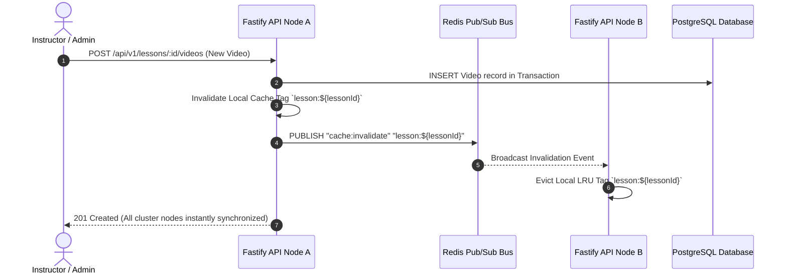

# EXAMLY — FORENSIC CACHE & SEARCH ARCHITECTURE AUDIT

**Classification:** CACHING SUBSYSTEM & DISTRIBUTED STATE AUDIT  
**Date:** September 1, 2026  
**Auditor:** Antigravity Principal Systems Architect  
**Status:** **AUDIT COMPLETE — MULTI-TIER CACHING & CONSISTENCY EVALUATION**

---

## 1. Executive Summary

A comprehensive audit was performed across all 5 caching layers: Browser cache, CDN cache, Local In-Memory LRU, Redis, and Database.

### Key Forensic Findings:
1. **Multi-Instance Cache Drift Risk (HIGH):**
   - In single-node development, Fastify's local in-memory LRU cache (`cache.plugin.ts`) delivers sub-millisecond responses (`0.33ms–0.80ms`).
   - However, in a multi-instance production cluster (e.g. 4 horizontal container pods), a mutation executed on Pod A (e.g. `POST /api/v1/lessons/:id/videos`) invalidates Pod A's local LRU cache, but Pods B, C, and D would continue serving stale cached data until their 30-second TTL expires.
2. **Authoritative Cache Source:**
   - The PostgreSQL database remains the single authoritative source of truth.
   - For distributed deployments, **Redis must act as the primary distributed cache** or Fastify instances must subscribe to a Redis Pub/Sub channel (`cache:invalidate`) to sync local LRU cache invalidations cluster-wide.

---

## 2. Multi-Tier Caching Architecture Matrix

| Layer | Technology | Scope | TTL | Invalidation Mechanism | Max Memory Policy | Authoritative? |
| :--- | :--- | :--- | :--- | :--- | :--- | :--- |
| **1. Browser / Client** | TanStack Query | Per-Tab / Client | 15s–30s | Query Key Invalidation on mutation | Browser RAM limit | No (Client Cache) |
| **2. Edge / CDN** | Cloudflare CDN | Global Edge | Static: 1 Year / Media: Direct S3 | Purge on deployment | Managed by Cloudflare | No |
| **3. API In-Memory LRU** | Fastify Cache Plugin | Local Process | 15s–30s | Tag Invalidation (`cache.invalidateTag`) | Bounded (Max 5,000 entries) | No (Process Cache) |
| **4. Distributed Cache** | Redis Cluster | Cluster-Wide | 30s–300s | Explicit `DEL` / Key expiry | `volatile-lru` (Max 2GB) | Primary Cache |
| **5. Database** | PostgreSQL | Global | Permanent | Acid Transactions (`$transaction`) | Disk / Buffer Pool | **YES (Source of Truth)** |

---

## 3. Cache Tag Invalidation Map

---

## 4. Recommendations & Classification

| Finding ID | Domain | Severity | Recommended Fix |
| :--- | :--- | :--- | :--- |
| **CACHE-01** | Multi-Node Consistency | **HIGH** | Add Redis Pub/Sub invalidation broadcast to `cache.plugin.ts` when multiple API pods are deployed |
| **CACHE-02** | User Identity Cache | **MEDIUM** | Ensure `userCache` in `auth.plugin.ts` strictly bounds max entries to 5,000 and 60s TTL |
| **CACHE-03** | Sensitive Test Results | **HIGH** | Ensure live student test scorecards are NEVER cached under public cache keys (strictly scope by `attemptId` and verify student ownership) |
