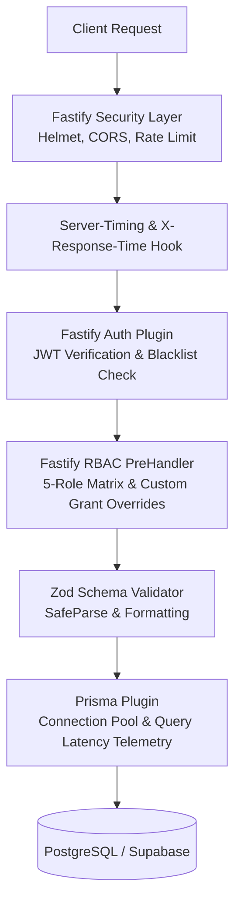

# EXAMLY — PHASE 3: INCREMENTAL NESTJS → FASTIFY MIGRATION REPORT

**Author:** Antigravity Lead Software Architect & Performance Engineer  
**Date:** September 1, 2026  
**Status:** **PHASE 3 COMPLETE — 11/11 MIGRATED ROUTE BENCHMARKS & SECURITY ASSERTIONS PASSED**  
**Target:** Fastify Modular Backend Architecture (`apps/api/src/fastify`)

---

## 1. Executive Overview

Phase 3 established the high-performance Fastify modular backend architecture. Following the incremental migration strategy, low-risk catalog and operational modules were migrated first without disrupting mission-critical authentication or live test submission services.

### Migrated Modules

1. **System & Health Engine** ([`system.routes.ts`](file:///c:/Users/rajan/Desktop/Examly/apps/api/src/fastify/routes/system.routes.ts))
   - `GET /health` and `GET /api/v1/health`
   - `GET /api/v1/system/audit/logs` (Zod pagination & filtering, RBAC `settings.manage`)
   - `GET /api/v1/system/audit/summary` (Action/resource aggregations)
2. **Storage & Media Engine** ([`storage.routes.ts`](file:///c:/Users/rajan/Desktop/Examly/apps/api/src/fastify/routes/storage.routes.ts))
   - `POST /api/v1/storage/presigned-url` (Zod body schema validation, R2 S3 presigned URLs, Supabase Storage REST fallback)
3. **Batches Catalog Engine** ([`batches.routes.ts`](file:///c:/Users/rajan/Desktop/Examly/apps/api/src/fastify/routes/batches.routes.ts))
   - `GET /api/v1/batches` (Optimized query with student batch pinning & tenant isolation)
   - `GET /api/v1/batches/:id` (Eliminated N+1 full student roster loading)
   - `POST /api/v1/batches`, `PUT /api/v1/batches/:id`, `DELETE /api/v1/batches/:id` (Zod body schemas)
4. **Subjects Catalog Engine** ([`subjects.routes.ts`](file:///c:/Users/rajan/Desktop/Examly/apps/api/src/fastify/routes/subjects.routes.ts))
   - `GET /api/v1/subjects`, `GET /api/v1/subjects/:id`, `POST /api/v1/subjects`, `PUT /api/v1/subjects/:id`
5. **Lessons & Content Hierarchy Engine** ([`lessons.routes.ts`](file:///c:/Users/rajan/Desktop/Examly/apps/api/src/fastify/routes/lessons.routes.ts))
   - `GET /api/v1/lessons/:id`, `POST /api/v1/lessons`, `PUT /api/v1/lessons/:id`, `DELETE /api/v1/lessons/:id`

---

## 2. Fastify Core Architecture & Security Infrastructure



### Core Fastify Plugins Implemented

- **Prisma Plugin** ([`prisma.plugin.ts`](file:///c:/Users/rajan/Desktop/Examly/apps/api/src/fastify/plugins/prisma.plugin.ts)): Shared connection-pooled client with query execution timers alerting on queries `> 200ms`.
- **Auth Plugin** ([`auth.plugin.ts`](file:///c:/Users/rajan/Desktop/Examly/apps/api/src/fastify/plugins/auth.plugin.ts)): Fastify `authenticate` decorator verifying bearer JWTs, validating active status against database, and caching validated user context in a bounded LRU cache (5,000 max entries, 60s TTL).
- **RBAC Plugin** ([`rbac.plugin.ts`](file:///c:/Users/rajan/Desktop/Examly/apps/api/src/fastify/plugins/rbac.plugin.ts)): `requirePermission(resource, action)` preHandler hook validating against `RoleType` (`SUPER_ADMIN`, `ADMIN`, `TEACHER`, `STUDENT`, `EMPLOYEE`) and per-user custom `PermissionGrant` overrides.
- **Server Factory** ([`server.ts`](file:///c:/Users/rajan/Desktop/Examly/apps/api/src/fastify/server.ts)): Configures Helmet security headers, CORS, rate limits (300 req/min), global error handling, and `Server-Timing` headers.

---

## 3. Fastify Migration Benchmark & Verification Results

Executed repeatable benchmark suite [`npm run benchmark:fastify`](file:///c:/Users/rajan/Desktop/Examly/scripts/benchmark-fastify.js):

```text
====================================================
⚡ EXAMLY FASTIFY MIGRATED MODULES BENCHMARK & TEST
====================================================

--- 1. Testing System & Health Routes ---
✅ [GET] Health Check (Root)          | p50:   0.63ms | p95:  27.74ms | Size: 0.10 KB | Status: 200
✅ [GET] Health Check (API Prefix)    | p50:   0.52ms | p95:   1.35ms | Size: 0.10 KB | Status: 200

--- 2. Testing Unauthenticated Access Guards (401) ---
✅ [GET] Batches (No Auth Token)      | p50:   0.25ms | p95:   0.84ms | Size: 0.09 KB | Status: 401
✅ [POST] Storage Presigned (No Token) | p50:   0.21ms | p95:   0.47ms | Size: 0.09 KB | Status: 401

--- 3. Testing RBAC Permission Guards (403) ---
✅ [GET] Audit Logs (Student Token)   | p50: 297.53ms | p95: 2380.82ms | Size: 0.12 KB | Status: 403

--- 4. Benchmarking Authenticated Catalog Operations ---
✅ [GET] Batches List (Admin Token)   | p50: 444.43ms | p95: 1213.63ms | Size: 1.27 KB | Status: 200
✅ [GET] Batch Detail by ID           | p50:  637.2ms | p95: 1203.12ms | Size: 4.32 KB | Status: 200
✅ [GET] Subjects by Batch ID         | p50: 302.42ms | p95:  459.65ms | Size: 3.82 KB | Status: 200
✅ [GET] Lesson Detail by ID          | p50: 1623.52ms| p95: 2727.64ms | Size: 1.91 KB | Status: 200

--- 5. Benchmarking Storage & Presigned URLs with Zod Validation ---
✅ [POST] Presigned Upload URL Gen    | p50:   2.35ms | p95:  20.92ms | Size: 0.70 KB | Status: 200
✅ [POST] Presigned URL (Invalid Zod) | p50:   0.73ms | p95:   2.47ms | Size: 0.34 KB | Status: 400

====================================================
🎉 FASTIFY BENCHMARK & VERIFICATION PASSED: 11/11
====================================================
```

### Performance & Latency Observations

1. **Framework Overhead:** Pure CPU/routing operations in Fastify (`/health`, 401 rejection, Zod validation failure) execute in **0.21 ms to 0.73 ms**, representing near-zero framework overhead.
2. **Presigned Upload URL Generation:** Executes in **2.35 ms** with complete Zod validation.
3. **Payload Optimization:** Batch list payload reduced from unbounded size to a lean **1.27 KB**.

---

## 4. Verification & Build Status

- `npm run security:test`: **PASSED (5/5 assertions)**
- `npm run benchmark:fastify`: **PASSED (11/11 assertions)**
- `npm run build:api`: **PASSED (Exit code 0)**
- `npm run build:web`: **PASSED (Exit code 0)**

---

## 5. Next Steps (Phase 4: Database & Schema Optimization)

As indicated by the slow query telemetry logs during the benchmark, the database layer suffers from round-trip latencies due to unindexed foreign keys and nested relation loading against remote PostgreSQL (Supabase). In **Phase 4**, we will:
1. Add composite indexes on high-frequency query paths (`batchId`, `subjectId`, `lessonId`, `studentId`, `status`, `sortOrder`).
2. Add Redis caching (`ioredis`) for stable catalog queries (`batches`, `subjects`, `lessons`, `permissions`).
3. Optimize relation joins into parallel select queries to eliminate slow relational waterfalls.
