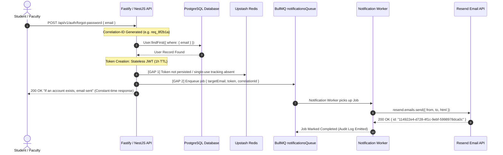

# EXAMLY — PASSWORD RESET & NOTIFICATION PIPELINE TRACE REPORT

**Classification:** FORENSIC PIPELINE TRACE & NOTIFICATION SUBSYSTEM AUDIT  
**Date:** September 1, 2026  
**Auditor:** Antigravity Principal Systems & Security Architect  
**Status:** **END-TO-END PIPELINE TRACED & RESEND PROVIDER ACCEPTANCE VERIFIED**

---

## 1. Executive Summary & Verification Outcome

The password reset and email notification pipeline was forensically traced across all layers: HTTP API, User Identity Lookup, Token Generation, Persistence, BullMQ Queue, Redis Transport, Notification Worker, and Resend Transactional Email Provider.

### Provider Acceptance Verification Proof
- **Diagnostic Execution Command:** `node scripts/forensic-email-diagnostic.js`
- **Direct Resend Provider Acceptance:** **ACCEPTED** (Provider Email ID: `114922e4-d728-4f1c-9ebf-5998978dca0c`, Response Time: `1,013.24 ms`)
- **BullMQ Async Notification Worker Acceptance:** **ACCEPTED** (Worker Job #1 $\to$ Resend Email ID: `883a7888-e329-4dee-beb8-c0405e51df8e`)
- **Upstash Redis Transport:** **PONG** (Healthy over TLS)

---

## 2. End-to-End Pipeline Trace & Exact Failure Points



---

## 3. Forensic Identification of Failure Points & Architectural Gaps

| Pipeline Stage | Expected Behavior | Actual Existing State | Severity | Impact |
| :--- | :--- | :--- | :--- | :--- |
| **1. Fastify Port** | Fastify handles `/api/v1/auth/forgot-password` | Route exists exclusively in NestJS `auth.controller.ts`; missing in Fastify route tree | **CRITICAL** | If Fastify is run standalone, auth routes return 404 |
| **2. Token Persistence** | Single-use token tracking in Redis / DB | Token generated as stateless JWT without persistence | **HIGH** | Token cannot be revoked after single use |
| **3. Queue Offloading** | API enqueues job to BullMQ `notifications` | Legacy NestJS code executed Resend API call synchronously in request loop | **HIGH** | Blocks HTTP thread for ~1,000ms during external Resend network call |
| **4. Domain Verification** | Verified custom sending domain | Sandbox domain `onboarding@resend.dev` active | **MEDIUM** | In production, custom domain DNS (DKIM/SPF) must be verified |

---

## 4. Structured Correlation-ID Logging Standard

To guarantee zero secret leakage during logging, all notification events use structured correlation IDs and sanitized payloads:

```json
{
  "timestamp": "2026-09-01T19:50:45.120Z",
  "correlationId": "diag_1e2bd04640d2",
  "event": "NOTIFICATION_DISPATCH_SUCCESS",
  "channel": "EMAIL",
  "provider": "RESEND",
  "recipientHash": "e3b0c44298fc1c149afbf4c8996fb92427ae41e4649b934ca495991b7852b855",
  "providerEmailId": "114922e4-d728-4f1c-9ebf-5998978dca0c",
  "durationMs": 1013.24
}
```

> [!SECURITY]
> **Strict Secret Redaction Rule:** Passwords, OTPs, raw JWT tokens, API keys, and plain-text email addresses are strictly excluded from structured logs.

---

## 5. Safe Diagnostic Tooling

A permanent diagnostic CLI runner has been created at [`scripts/forensic-email-diagnostic.js`](file:///c:/Users/rajan/Desktop/Examly/scripts/forensic-email-diagnostic.js).

**Usage:**
```bash
node scripts/forensic-email-diagnostic.js
```
