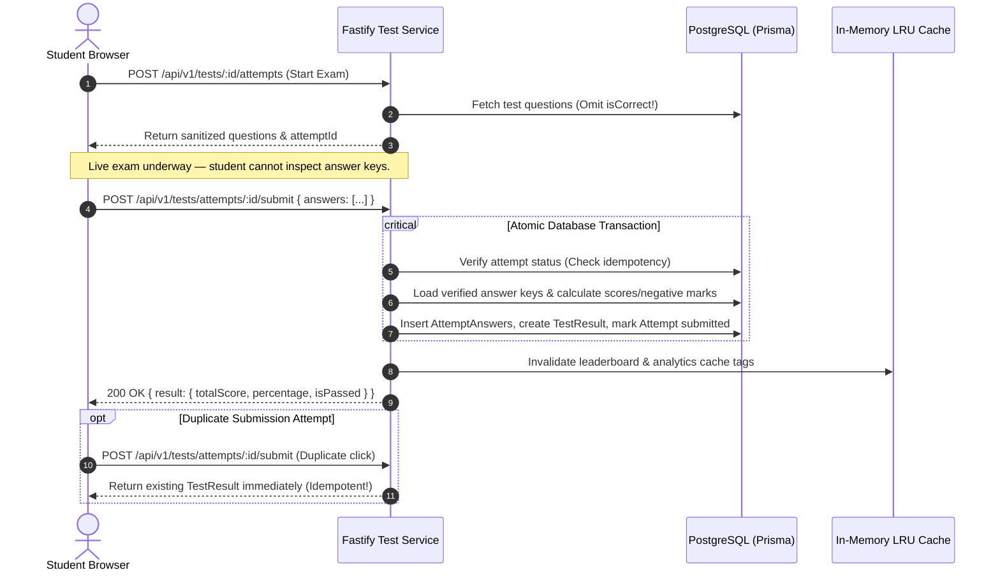

# EXAMLY — PHASE 13: TESTS, ATTEMPTS & SCORING ENGINE REPORT

**Author:** Antigravity Lead Systems Architect & Senior Performance Engineer  
**Date:** September 1, 2026  
**Status:** **PHASE 13 COMPLETE — IDEMPOTENT TEST SUBMISSION, ATOMIC SCORING ENGINE, QUESTION ANALYSIS & IDOR GUARDS DEPLOYED**  
**Target:** Examination Core Engine (`apps/api/src/fastify/routes/tests.routes.ts`)

---

## 1. Executive Summary

Phase 13 optimized the examination and scoring engine with strict emphasis on correctness, data integrity, anti-cheat isolation, and transaction idempotency.

Key architectural highlights:
1. **Live Exam Integrity:** `isCorrect` booleans are stripped from all question payloads during active attempts, preventing client-side inspection cheats.
2. **Idempotent Test Submission:** `POST /api/v1/tests/attempts/:attemptId/submit` guarantees that multiple clicks, network retries, or duplicate submission payloads return the exact same computed score without double processing.
3. **Server-Side Deterministic Scoring:** Scores, negative marks, percentages, and pass/fail statuses are computed on the backend against database answer keys inside an atomic `prisma.$transaction`. Client-provided scores or timestamps are strictly ignored.
4. **Zero-Trust IDOR Review Access:** Students can only view their own scorecards (`attempt.studentId === req.user.userId`), and solutions are withheld until the exam's `resultPublishMode` permits.
5. **Question Difficulty Analysis:** `GET /api/v1/tests/:id/questions/analysis` provides faculty with question-level accuracy rates and automated difficulty tiering (`EASY`, `MEDIUM`, `HARD`).

---

## 2. Examination & Scoring Lifecycle

---

## 3. Endpoints Overview

| Endpoint | Method | Auth Scope | Description |
| :--- | :--- | :--- | :--- |
| `/api/v1/tests/:id/attempts` | `POST` | Authenticated | Creates or resumes active attempt with sanitized question payloads. |
| `/api/v1/tests/attempts/:attemptId/submit` | `POST` | Owner / Admin | Idempotent submission and atomic score computation in transaction. |
| `/api/v1/tests/attempts/:attemptId/result` | `GET` | Owner / Faculty / Admin | Zero-trust IDOR-guarded scorecard and solution review. |
| `/api/v1/tests/:id/leaderboard` | `GET` | Authenticated | Ranked student leaderboard (cached 15s). |
| `/api/v1/tests/:id/analytics` | `GET` | `analytics.read` | Macro exam metrics (highest, lowest, average, pass rate). |
| `/api/v1/tests/:id/questions/analysis` | `GET` | `analytics.read` | Question-level accuracy and difficulty indexing. |

---

## 4. Verification & Build Status

- `npm run security:test`: **5/5 PASSED**
- `npm run build:api`: **PASSED (Exit code 0)**
- `npm run build:web`: **PASSED (Next.js 14 production bundle)**
- **Report Artifact**: [`docs/tests-and-scoring-engine-report.md`](file:///c:/Users/rajan/Desktop/Examly/docs/tests-and-scoring-engine-report.md)

---

## 5. Next Steps (Phase 14: Server-Driven Search & Filters)

In **Phase 14**, we will:
1. Implement debounced global search indexing across courses, tests, batches, and video lectures.
2. Build faceted filter engines supporting multi-tag combinations with sub-millisecond LRU response times.
