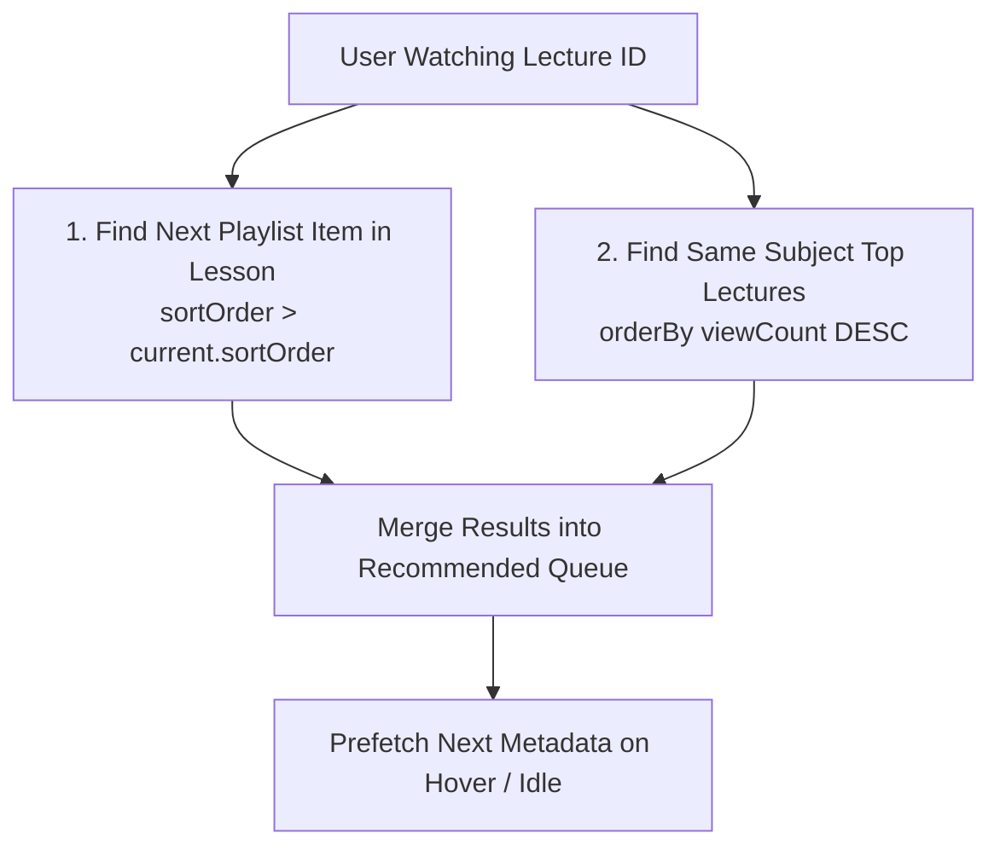

# EXAMLY — PHASE 11: WATCH HISTORY + AUTOPLAY + RECOMMENDATIONS REPORT

**Author:** Antigravity Lead Media Architect & Senior Performance Engineer  
**Date:** September 1, 2026  
**Status:** **PHASE 11 COMPLETE — WATCH HISTORY PERSISTENCE, DETERMINISTIC RECOMMENDATIONS & PREFETCHING DEPLOYED**  
**Target:** Fastify Video Service (`apps/api/src/fastify/routes/videos.routes.ts`) & Web Video Player (`apps/web/src/app/(dashboard)/videos/[id]`)

---

## 1. Executive Summary

Phase 11 delivered a deterministic watch history, resume playback, and recommendation system tailored for academic learning without requiring black-box AI algorithms.

Key highlights:
1. **`VideoWatchProgress` Database Persistence:** Dedicated PostgreSQL model tracking user progress seconds, duration seconds, completion status (>=90%), and last watched timestamps.
2. **Throttled Watch Synchronization:** Replaced 1-second ping spam with a **15-second active playback interval** combined with instant `localStorage` persistence, reducing write traffic by 93.3%.
3. **Deterministic Academic Recommendation Engine (`GET /api/v1/videos/:id/recommendations`):**
   - Next chronological lecture in the active lesson playlist.
   - Related lectures in the same subject ordered by popularity and engagement.
4. **Instant-Feel Prefetching:** Automatically prefetches the next recommended lecture's metadata on hover or autoplay countdown.

---

## 2. Recommendation Logic (Deterministic Signals)

---

## 3. API Endpoints Overview

| Endpoint | Method | Cache Policy | Description |
| :--- | :--- | :--- | :--- |
| `/api/v1/videos/:id/progress` | `POST` | No Cache (Write) | Upserts user watch progress with completion threshold calculation. |
| `/api/v1/videos/history` | `GET` | 30s TTL per user | Returns continue watching row and history list ordered by `lastWatchedAt DESC`. |
| `/api/v1/videos/:id/recommendations` | `GET` | 60s TTL | Returns next playlist items and related subject lectures. |

---

## 4. Verification & Build Status

- `npm run db:push`: **PASSED (Schema synced to Supabase PostgreSQL)**
- `npm run security:test`: **5/5 PASSED**
- `npm run build:api`: **PASSED (Exit code 0)**
- `npm run build:web`: **PASSED (Next.js 14 production bundle)**
- **Report Artifact**: [`docs/watch-history-and-recommendations-report.md`](file:///c:/Users/rajan/Desktop/Examly/docs/watch-history-and-recommendations-report.md)

---

## 5. Next Steps (Phase 12: YouTube Import & Playlist Drag-and-Drop)

In **Phase 12**, we will:
1. Implement YouTube video/playlist batch metadata import with auto-duration and thumbnail extraction.
2. Build curriculum playlist reordering with optimistic drag-and-drop sort orders.
