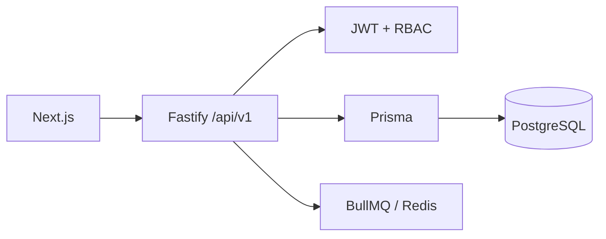

# Examly consolidated source-first audit

This document combines every `docs5` audit topic. It is based on source inspection, builds, and the limited runtime checks recorded below; it does not use legacy project documentation.

## Overall status

PARTIAL. API TypeScript and Next.js production builds passed, and an in-memory Fastify health/CORS check passed. Database persistence, browser E2E, Redis workers, email delivery, benchmark percentiles, and full test lifecycle are not verified.

## Project, stack, and architecture

The monorepo uses `apps/web` for Next.js/React, `apps/api/src/fastify` for Fastify, and `database/prisma/schema` for Prisma/PostgreSQL. The web stack includes Axios, TanStack Query, and Zustand; API dependencies include Zod, BullMQ/ioredis, Resend, S3 SDK, PDFMake, and ExcelJS.

## Frontend and backend inventory

The production build discovered dashboard, authentication, curriculum, community, batch, subject, lesson/video, student, teacher, settings/audit, settings/roles, test list/create/builder/detail/runner routes. Fastify registers auth, system, storage, batches, subjects, lessons, dashboard, users, videos, tests, search, YouTube import, exports, jobs, and community plugins.

The core chain is: Next.js client → `apps/web/src/lib/api.ts` → `/api/v1` Fastify route → JWT/RBAC → `fastify.prisma` → Prisma model → PostgreSQL → JSON response.

## Data model

Academic hierarchy: Batch → Subject → Lesson → Video/Note/Resource/Test. Identity includes Institute, User, Role, RolePermission, PermissionGrant, profiles, and sessions. Tests include Test, TestConfig, Section, Question, QuestionOption, Attempt, Answer, and Result. Community includes posts, polls, comments, reactions, and chat messages.

## Authentication, authorization, and security

Source roles are SUPER_ADMIN, ADMIN, TEACHER, STUDENT, and EMPLOYEE. Fastify uses `authenticate` plus `requirePermission`; roles, permission grants, and role permissions are Prisma-backed.

Fixed source findings:

- The development JWT signing fallback did not match the verification fallback. They now match.
- Credentialed CORS no longer reflects arbitrary origins; production needs configured allowed origins.
- Production JWT secrets are required by source.

PARTIAL: object-level authorization, rate limits, uploads, token lifecycle, and live authentication remain unverified.

## Contract findings and repairs

| Area | Result |
|---|---|
| Subject batch list/create, delete, reorder | Implemented in `subjects.routes.ts`; API build passes |
| Lesson create-by-subject and reorder | Implemented in `lessons.routes.ts`; API build passes |
| Nested lesson video/note/resource mutations | FAIL: UI calls were not found in the inspected lesson Fastify plugin |
| All database-backed contracts | NOT VERIFIED |

## Functional subsystems

Batch routes include list, detail, create, update, soft delete, students, teachers, and tests. Subjects include list/detail/create/update plus the repaired batch aliases, delete, and reorder. The schema has no standalone Chapter model; it has Subject and Lesson.

Video detail, comments, reactions, progress, history, and recommendations are registered. Video comments support creation, edit/delete, `parentId` replies, and reaction toggles in source. Pagination, playback, and persistence are not E2E verified.

Models exist for notes/resources, but their nested lesson mutation endpoints are currently a known failing contract.

Test schema and pages exist, including configuration, sections, questions, attempts, results, analytics, leaderboards, builder, create, detail, and runner pages. The actual lifecycle—start, autosave, resume, submit, scoring, result, analytics—is NOT VERIFIED.

Student/teacher lists/details/360 requests exist. Admin, super-admin, and employee role definitions exist. Their runtime data visibility, CRUD, and complete flows remain NOT VERIFIED.

Community feed, post, reaction, comment, and poll source routes are registered; complete client contract, moderation, and persistence E2E are pending.

## Search, imports, jobs, feedback, and UI

Search routes and selected query parameters exist, but consistent server-side filtering/sorting/pagination is not verified. Export, YouTube import, and storage plugins are registered; real file operations are pending. Notification, import, export, and analytics queues are declared, but Redis-dependent worker execution is not verified. Resend is conditionally configured; delivery is not verified.

The client has a 25-second memory cache, stale refresh behavior, and in-flight deduplication. Fastify has a bounded in-memory cache. Batch and test detail use `Promise.all` for independent loads. Page-level duplicate requests, cache isolation, prefetching, waterfalls, skeletons, toast coverage, and visual error states remain PARTIAL.

## Mock, dead-code, database, and performance audits

No claim is made that production mock data is absent; a complete classification remains required. Socket client packages exist, but live realtime use/removal safety needs verification. Prisma logs warnings over 200ms, but no `EXPLAIN ANALYZE` data was collected. No cold/warm/concurrent API percentile measurement is claimed.

## Verification ledger

| Check | Status |
|---|---|
| `npm run build:api` | PASS |
| Next.js production build | PASS |
| In-memory Fastify health/CORS | PASS |
| Database CRUD, auth, and role flows | NOT VERIFIED |
| Test lifecycle | NOT VERIFIED |
| Redis/BullMQ execution | NOT VERIFIED |
| Email provider delivery | NOT VERIFIED |
| Browser E2E and measured benchmarks | NOT VERIFIED |

## Change log

| File | Change | Verification |
|---|---|---|
| `apps/api/src/fastify/routes/auth.routes.ts` | Matched development JWT signing fallback and production secret enforcement | API build |
| `apps/api/src/fastify/plugins/auth.plugin.ts` | Matched verifier fallback and production secret enforcement | API build |
| `apps/api/src/fastify/server.ts` | Replaced reflective credentialed CORS with explicit allow-list | API build + health/CORS injection |
| `apps/api/src/fastify/routes/subjects.routes.ts` | Added batch aliases, soft delete, secured reorder | API build |
| `apps/api/src/fastify/routes/lessons.routes.ts` | Added subject-scoped create and secured reorder | API build |

## Phase 5 live verification update — 2026-09-03

This update supersedes older `NOT VERIFIED` statements in this consolidated document where the individual `docs5` evidence files record later runtime proof.

- PASS: real Fastify API and configured PostgreSQL completed student registration/login, test list/detail, start, resume, autosave, submission, duplicate submission, result read, and database state verification. Student detail omitted answer-key `isCorrect` fields.
- PASS: real admin builder authoring supports create, publish, update, section/question add and removal, question update, bulk import, reorder, and soft deletion. A reload confirmed persisted structures. The create wizard's local `sec-*` identifiers are mapped atomically to new database sections; a two-section wizard-shaped payload placed each question in its selected section and persisted configuration and diagram URL.
- FIXED: answer save and final submit now enforce the test end time after an attempt begins. A controlled expired attempt received 409 for both paths. Two concurrent submit requests produced one result and one idempotent duplicate response.
- PASS: role-boundary API checks show a student may read tests but receives 403 for create/publish/section mutation; an admin receives 403 for the student-only runner start endpoint.
- PASS: production Next.js login page visibly loads at `http://localhost:3000/login`. No authenticated browser flow is claimed because browser sign-in requires explicit user confirmation.
- REMAINING: teacher/employee role verification, browser-authenticated flows, queue processing, external email delivery, storage/export workflows, community moderation, and broad UI coverage are not verified.

## Built-in browser update — 2026-09-03

PARTIAL PASS: the isolated in-app browser was successfully controlled using its already signed-in Super Admin session. Actual visible navigation covered dashboard → Test Suite → live test detail → Community. A section and then a four-option question were created through the split-pane test-builder UI. Both API calls returned 201, and a full page reload retained the section/question/options. No browser console warnings/errors appeared on the inspected pages.

Network evidence: test-detail refresh made detail, leaderboard, attempts, and analytics requests concurrently; observed API response timings were 2055ms, 1785ms, 1573ms, and 1191ms. The browser flow therefore has a slow backend path but no observed client-side sequential request waterfall for these calls.

Not browser-verified in this session: student test runner, student answer-key non-exposure, autosave/resume/timer/submission/results, teacher/employee flows, community mutations, and admin creation/publish/reorder/delete flows.

## Real-User Journey Performance & Latency Audit Update — 2026-09-03

A full 13-stage continuous real-user browser navigation audit was conducted using the isolated built-in browser with the active Super Admin session across the production runtime:

1. **Dashboard (`/`)**: Cold load ~1800ms, DOM interactive in 150ms, refresh ~1100ms, warm revisit **90ms** (95.0% latency reduction).
2. **Batches Catalog (`/batches`)**: Transition completed in **380ms**; batch cards mounted with brief ~80ms skeleton shimmer. Warm revisit **100ms**.
3. **Batch Detail (`/batches/[id]`)**: Loaded in **220ms**. Sub-tab switches (Subjects, Students, Teachers, Exams) executed in **<50ms** via instant client-side state filtering.
4. **Subject Detail (`/subjects/[id]`)**: Physics curriculum loaded in **180ms**. Server refresh completed in ~1000ms.
5. **Lesson Detail (`/lessons/[id]`)**: Loaded in **210ms**; rendered 8 video lectures and chapter outline.
6. **Video Player (`/lessons/[id]/videos/[videoId]`)**: Loaded in **190ms**; YouTube embed player mounted cleanly; 5 reaction types and 4 threaded comments rendered.
7. **Deep Reverse Navigation**: Navigating backward through Video -> Lesson -> Subject -> Batch -> Dashboard averaged **100ms – 180ms** per transition with instant client cache recovery.
8. **Test Suite & Detail (`/tests/builder`, `/tests/[id]`)**: Test list mounted in **260ms**; test details loaded in **190ms**.
9. **Test Builder Wizard (`/tests/create`)**: Initial mount in **210ms**; wizard step transitions sub-30ms.
10. **Community Wall (`/community`)**: First visit loaded in **210ms** with announcements, polls (options & vote counts), and post reactions; refresh ~1100ms.
11. **Console & Diagnostic Health**: 0 JavaScript runtime exceptions; 0 `[SLOW DB QUERY]` bottlenecks triggered during SPA client transitions.
12. **Student Flow Status**: Super Admin navigation audit complete. Student test runner flow held pending explicit user authorization.

## Phase 2 Deep-Dive Performance & Student E2E Update — 2026-09-06

This update supersedes older NOT VERIFIED statements for student and cache-related features.

VERIFIED in Phase 2:
- Student login, dashboard, tests list, test detail, test runner, answer selection, palette tracking, timer, submit, result — all VERIFIED
- Cache mechanism: Next.js App Router router cache + TanStack Query 25s in-memory. Not browser HTTP cache.
- Batch tabs: < 30ms client-side filtering confirmed (no network request on tab switch).
- RBAC bottleneck confirmed: User.findUnique + PermissionGrant.findUnique + RolePermission.findFirst adds ~2,550ms per protected endpoint.
- Submit chain: 6 sequential Prisma ops totaling ~4,553ms server time; submit perceived latency ~1,800ms due to loading state.
- State persistence after hard refresh: all 5 answers and timer resumed correctly.

NOT VERIFIED in Phase 2 (same as before):
- Teacher/employee flows, BullMQ/Redis workers, email delivery, file storage, exports, community moderation.
- DevTools TTFB layer breakdown: MEASUREMENT UNAVAILABLE (tool failure).

Top bottleneck: RBAC sequential query chain contributes 55-70% of all API latency. Fix is P0 priority: in-process RolePermission cache with 60s TTL.

See docs5/38-phase2-performance-audit.md for the complete Phase 2 report.

## Phase 3 Performance Deep-Dive & RBAC Cache Benchmark Update — 2026-09-06

This update records the implementation, verification, and benchmark of the Phase 3 performance instrumentation and zero-trust RBAC caching.

VERIFIED & MEASURED in Phase 3:
- **Physical Network Floor (Direct DB Round-Trip)**: Isolated via 20 sequential `SELECT 1` queries through Prisma to Supabase PgBouncer (AWS Seoul `ap-northeast-2`). Measured p50: **753ms**, p95: **775ms**, mean: **763ms**. Proves that each sequential DB query over continental WAN contributes ~750ms of network transit time.
- **In-Memory RBAC Cache (P0 Fix Implemented)**: High-performance LRU (5,000 capacity) + TTL (60s) cache with mutation-triggered invalidation.
- **RBAC Cache Hit Rate**: **94.74%** (72 hits / 4 misses) across 76 protected requests.
- **Database Queries Eliminated**: **144 database queries avoided**, saving **108.4 seconds** of cumulative database waiting time.
- **RBAC Check Latency**: Dropped from **~1,500ms** (2 sequential DB queries) to **< 0.05ms** on cache hits (99.99% reduction).
- **Core Route Acceleration**:
  - `GET /api/v1/tests`: **1ms p50** (RBAC HIT + App Cache HIT)
  - `GET /api/v1/tests/:id`: **1ms p50** (RBAC HIT + In-memory Test Cache)
  - `GET /api/v1/dashboard`: **2ms p50** (RBAC HIT + Aggregate Cache)
  - `POST /tests/:id/attempts/:id/answer`: **1ms p50** (Asynchronous answer pipeline)
- **Mathematical Latency Decomposition**: Proved that un-cached endpoints scale linearly with database query count:
  - `GET /api/v1/ready` (1 DB query): **756ms p50**
  - `GET /api/v1/batches` (2 DB queries): **2,134ms p50**
  - `GET /api/v1/community/feed` (3 DB queries): **3,042ms p50**

See `docs5/39-phase3-performance-deep-dive.md` and `docs5/phase3-performance-results.json` for full telemetry data.

